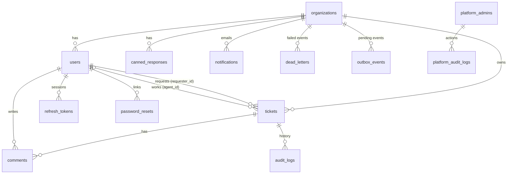

# Database guide

PostgreSQL 17, one database, one schema (`public`). Tables are created by numbered files in
`helpdesk-backend/db/migrations/` (never edit one that has been applied; add a new one). Every table and column has a
description stored in the database itself: in DBeaver open a table and read the **Comment** column, or run
`\d+ tickets` in psql.

## Reading the data easily: the `v_*` views

UUIDs are hard to read. These views show names and emails instead. They are **read-only** (to change data, edit the
underlying table).

| View | Shows |
|---|---|
| `v_organizations` | each organisation with status and counts of admins, agents, customers, tickets, open tickets |
| `v_users` | users with their organisation name |
| `v_tickets` | tickets with organisation, requester email and assignee email |
| `v_comments` | comments with ticket subject and author |
| `v_audit_logs` | ticket history with who did it |

```sql
select * from v_organizations;
select organisation, subject, status, requester, assigned_to from v_tickets where status = 'OPEN';
```

Connected as the database owner (`helpdesk`, what DBeaver uses) you see every organisation. The running app connects as
the restricted role `helpdesk_app`, so through the app each organisation sees only its own rows.

## Editing data

Edit the **tables** directly in DBeaver (as the owner; Row-Level Security does not apply to the owner). Good to know:

- `users.email` must be lowercase (a check constraint enforces it).
- Setting `users.is_active = false`, changing `users.role`, or setting `organizations.suspended_at = now()` takes effect
  within about 5 seconds: the API re-checks the database (briefly cached) on every request and WebSocket connection, so
  a person's open session stops working even though a direct SQL edit cannot revoke it. Their refresh token is refused too.
  The platform console does the same immediately and also writes an audit record, so prefer it.
- Never put a plain password into `password_hash`. Use the app or `npm run platform:create-admin`.

For routine changes (plan, SLA, suspend, roles, deactivation) use the **Platform console** at `/platform`; it also ends
sessions at once and writes an audit record.

## Entity relationships



## Tables

**Tenant data** (every one has `org_id`, an index starting with `org_id`, and a Row-Level Security policy):

| Table | Purpose |
|---|---|
| `organizations` | the tenants (company), plan, SLA minutes, suspension |
| `users` | admins, agents, customers of an organisation; unique `(org_id, email)` |
| `tickets` | support requests: status, priority, requester, agent, SLA deadline and breach |
| `comments` | messages on a ticket; `is_internal_note` = staff only |
| `audit_logs` | append-only ticket history |
| `notifications` | emails sent or failed |
| `canned_responses` | saved replies |
| `dead_letters` | events a background job gave up on (admin "Failed events" page) |
| `outbox_events` | events waiting to be published to Kafka |
| `refresh_tokens` | login sessions (hashes only) |
| `password_resets` | single-use reset and invitation links (hashes only) |

**Platform data** (no `org_id`; only the super admin console can use it):

| Table | Purpose |
|---|---|
| `platform_admins` | super admins; not readable by the app role directly |
| `platform_audit_logs` | append-only record of what super admins did and which tickets they opened |

`schema_migrations` records which migration files are applied.

## Conventions

- Primary keys are UUIDs (`outbox_events` uses a number; `platform_audit_logs` uses an identity number).
- Timestamps are `timestamptz`, named `created_at`, `updated_at`, `*_at`.
- Foreign keys to users from tenant tables are composite `(user id, org_id)`, so a row can never point at another
  tenant's user.
- Status-like columns (`status`, `priority`, `role`, `plan`) are text with `CHECK` constraints listing the allowed values.
- Rows are not deleted when people leave: users are deactivated, so tickets and comments keep their author.

## Security in the database

1. The app connects as `helpdesk_app`, which owns nothing and cannot bypass Row-Level Security.
2. Before each query the app sets `app.current_org_id` (from the verified login token). Policies show a row only if
   its `org_id` matches. No setting, no rows.
3. The super admin console sets `app.platform_admin = 'on'` for its own transactions; extra `platform_*` policies allow
   reading every tenant and editing organisations, users and sessions, and nothing else. Tenant requests never set it.
4. Narrow `SECURITY DEFINER` functions are the only other cross-tenant doors: `auth_lookup_user` (login),
   `outbox_claim` / `outbox_complete` (event relay), `sla_pending_timers`, and the three `platform_*` admin functions.

## Handy queries

```sql
-- Which organisations are busiest?
select name, tickets, open_tickets from v_organizations order by tickets desc;

-- Tickets that missed their SLA
select organisation, subject, priority, requester from v_tickets where sla_breached;

-- What did the super admin do recently?
select created_at, admin_email, action, org_id, details from platform_audit_logs order by id desc limit 20;

-- Failed background events
select o.name, d.consumer, d.event_type, d.error, d.attempts from dead_letters d join organizations o on o.id = d.org_id;
```
